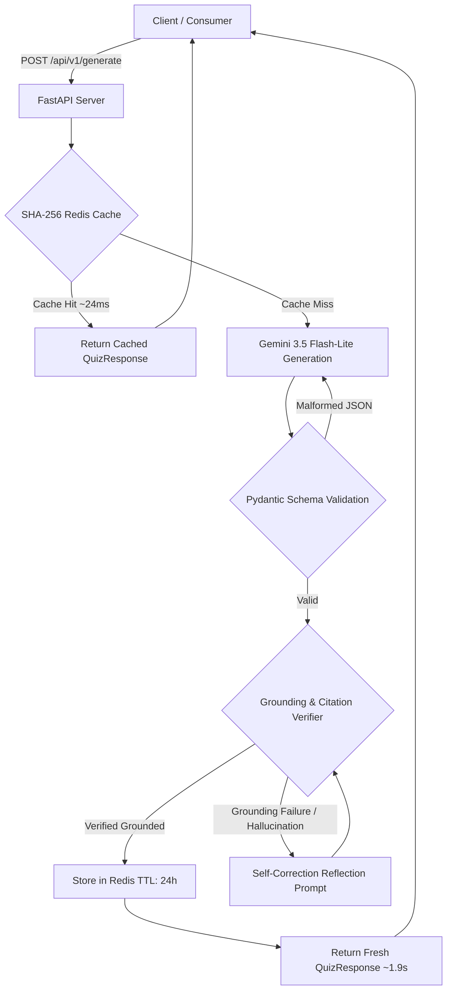

```markdown
# QuizGen — Production Assessment Engine & Evaluation Harness

A production-grade, self-correcting educational assessment engine built with **FastAPI**, **Pydantic**, **Redis**, and the **Google GenAI SDK**[cite: 1]. 

The platform guarantees deterministic data schemas, validates grounding against hallucinated content through an automated self-correcting reflection loop, caches duplicate requests via SHA-256 Redis digests in under 25ms, and audits generation quality with an offline LLM-as-a-judge evaluation harness[cite: 1].

---

## ⚡ Architectural Highlights

* **Deterministic Contract Enforcement**: Enforces strict Pydantic models (`QuizResponse`, `GeneratedQuestion`) across generation passes to eliminate malformed JSON responses and type drift[cite: 1].
* **Self-Correcting Grounding Audit**: Cross-references every generated question and distractor option against source text via substring quote verification; automatically triggers a targeted regeneration loop if grounding fails[cite: 1].
* **Sub-25ms SHA-256 Redis Cache**: Hashes normalized request tuples `(topic, count, context)` into SHA-256 digest keys, returning warm cache hits in **~24ms** (down from a ~1,978ms cold start, a **98.8% latency reduction**)[cite: 1].
* **Automated LLM-as-a-Judge Evaluation Suite**: Features an offline benchmark runner (`benchmarks/run_evals.py`) scoring test sets across technical domains for faithfulness, answer unambiguity, and hallucination rates[cite: 1].
* **Containerized Infrastructure**: Dockerized Redis broker and ASGI FastAPI runner designed for zero-configuration local orchestration[cite: 1].

---

## 🔄 System Architecture



---

## 📊 Evaluation & Latency Metrics

### Offline Benchmark Suite (`benchmarks/run_evals.py`)

Tested across 5 complex computer science domains (Operating Systems, Database Internals, Distributed Systems, Computer Networking, Machine Learning) using `golden_dataset.json`:

| Metric | Measured Score | Target Threshold | Status |
| --- | --- | --- | --- |
| **Faithfulness Score** | **100.00%** | > 95.0% | PASS

 |
| **Unambiguity Score** | **100.00%** | > 95.0% | PASS

 |
| **Hallucination Rate** | **0.00%** | < 5.0% | PASS

 |
| **Schema Compliance** | **100.00%** | 100.0% | PASS

 |

### Latency Profiles

* **Cold Generation (p50)**: `1,977.97 ms` (Includes LLM inference, Pydantic schema validation, and citation audit)


* **Warm Hit (Redis SHA-256)**: `24.66 ms` (**98.8% latency reduction**; zero token inference costs)


---

## 📁 Repository Layout

```text
QuizGen/
├── app/
│   ├── api/
│   │   └── v1/
│   │       ├── endpoints.py     # FastAPI generation and health routes
│   │       └── schemas.py       # Pydantic data contracts (QuizResponse, Question)
│   ├── core/
│   │   ├── config.py            # Environment configuration & dotenv loading
│   │   └── cache.py             # SHA-256 Redis caching layer
│   ├── services/
│   │   ├── generator.py         # Google GenAI orchestration & self-correction loop
│   │   └── verifier.py          # Ground-truth citation and distractor auditor
│   └── main.py                  # ASGI FastAPI application factory
├── benchmarks/
│   ├── golden_dataset.json      # Ground-truth technical passages
│   └── run_evals.py             # LLM-as-a-judge evaluation benchmark script
├── Dockerfile                   # Multi-stage production container image
├── docker-compose.yml           # Local multi-service orchestration
├── requirements.txt             # Pinned project dependencies
├── .env.example                 # Environment variable template
└── README.md                    # System architecture & documentation

```

---

## 🚀 Quickstart

### 1. Prerequisites

* Python 3.11+
* Docker Desktop (for Redis container)
* Google Gemini API Key

### 2. Environment Configuration

Clone the repository and copy the environment configuration:

```bash
git clone [https://github.com/BryanZhao06/QuizGen.git](https://github.com/BryanZhao06/QuizGen.git)
cd QuizGen
cp .env.example .env

```

Edit `.env` with your credentials:

```env
GEMINI_API_KEY=your_gemini_api_key_here
REDIS_URL=redis://127.0.0.1:6380/0

```

### 3. Start Redis Cache Broker

Launch the Redis cache container mapped to host port `6380`:

```bash
docker run -d --name quizgen_redis -p 127.0.0.1:6380:6379 redis:7-alpine

```

### 4. Run Locally

Create and activate a virtual environment, then install requirements:

```bash
python -m venv .venv
source .venv/bin/activate  # Windows: .venv\Scripts\Activate.ps1
pip install -r requirements.txt

```

Start the FastAPI application:

```bash
python -m uvicorn app.main:app --host 0.0.0.0 --port 8000

```

Interactive OpenAPI documentation will be available at:

```text
http://localhost:8000/docs

```

---

## 🧪 Running the Offline Benchmark Suite

Execute the automated LLM-as-a-judge benchmark harness across the golden dataset passages:

```bash
python -m benchmarks.run_evals

```

Sample output:

```text
================ STARTING EVALUATION BENCHMARK ================
Loaded 5 benchmark documents (Batch Mode: 2 calls/doc).
[1/5] Testing 'Operating Systems'...
[2/5] Testing 'Database Internals'...
[3/5] Testing 'Distributed Systems'...
[4/5] Testing 'Computer Networking'...
[5/5] Testing 'Machine Learning'...

================ EVALUATION SUMMARY ================
Total Evaluated Questions: 15
Faithfulness Score:        100.00% (Target: >95%)
Unambiguity Score:         100.00% (Target: >95%)
Hallucination Rate:        0.00% (Target: <5%)

```

---

## 🛠️ API Specification

### `POST /api/v1/generate`

#### Request Body

```json
{
  "topic": "Distributed Systems",
  "num_questions": 2,
  "context": "The Raft consensus algorithm decomposes replicated state machine management into leader election, log replication, and safety. A cluster elects a single leader that accepts client write requests, creates log entries, and synchronizes them across a majority quorum of follower nodes."
}

```

#### Response (`200 OK`)

```json
{
  "quiz_id": "d6fa7360-8a74-4000-b23a-72b3430e09c2",
  "topic": "Distributed Systems",
  "total_questions": 2,
  "questions": [
    {
      "question_text": "What are the three main sub-problems into which the Raft consensus algorithm decomposes replicated state machine management?",
      "options": [
        { "label": "A", "text": "Leader election, log replication, and safety" },
        { "label": "B", "text": "Client requests, quorum synchronization, and failover" },
        { "label": "C", "text": "State machine partitioning, voting, and recovery" },
        { "label": "D", "text": "Node discovery, consensus verification, and persistence" }
      ],
      "correct_option": "A",
      "explanation": "The text explicitly states that Raft decomposes replicated state machine management into leader election, log replication, and safety.",
      "source_quote": "The Raft consensus algorithm decomposes replicated state machine management into leader election, log replication, and safety.",
      "difficulty": "easy"
    }
  ]
}

```

```

```